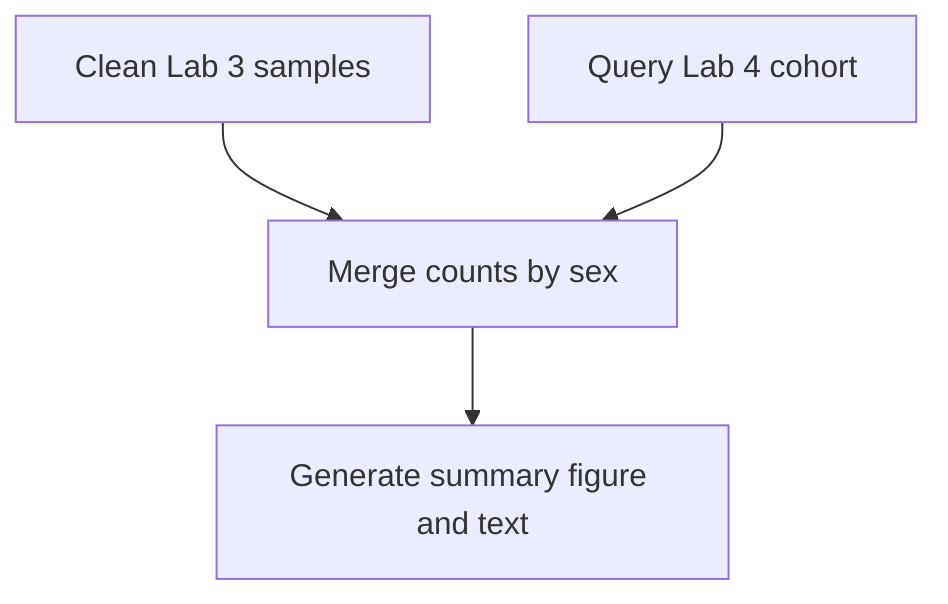

# Lab 5 - Scalable Analysis workflow
## Repo Overview

| File | Description |
|---|---|
| `Snakefile` | Creates DAG, defines worflow|
| `clean_1.R` | Reuses Lab 3 script to clean the sample data |
| `build_features.py` | Reuses Lab 4 python script that creates feature table |
| `merge_tables.R` | Combines sample and patient counts by sex category (did before crossed out on lab |
| `results/combined.csv` | Final combined table |
| `results/summary.png` and `results/summary.md` | Summary figure and text report |
| `evidence/clean-run.txt` and `evidence/partial-rerun.txt` | Console logs from both runs |
| `AI_USAGE.md` | Documentation of AI assistance |

Requirements:
Python3
Pandas
Snakemake
R
tidyverse
lubridate
SQLite (sqlite3)

Instructions:
1. Clone repository (git clone)
2. If build_feautures.py or clean_1.R are missing, copy files from my previous repos [Lab 3](https://github.com/iberdecio3-gw/lab3) and [Lab 4](https://github.com/iberdecio3-gw/lab4)

## Task Requirements

1. Define the pipeline as a DAG using Snakemake or Nextflow (your choice) with at least these stages:
   - `clean_samples` cleans the Lab 3 data
   - `query_cohort` reads `cohort.db` and builds Lab 4 feature table
   - `merge_tables` merges counts by sex because they don't share ID. I kept this step after the assignment update
   - `report` uses the combined table to create the summary figure + text
  

2. Make each rule/process declare its real inputs and outputs — no step should silently depend on files not declared to the workflow engine.Prove it's re-runnable and scalable:
  - Each rule lists inputs/outputs.
  - Run the full pipeline from a clean state (delete outputs, re-run): Clean run - Deleted generated and reran (`evidence/clean-run.txt`). All 5 steps complete.
  - Change one upstream input and show that only the affected downstream steps re-run (not everything) — take a screenshot or paste console output showing this: Partial run - Changed some data in the original file and reran. 4 out of 5 steps complete, querying skipped (evidence/partial-rerun.txt)
    
3. Document AI assistance used in writing the workflow rules (Snakemake/Nextflow syntax is a common place students use AI help — that's fine, just declare it) (AI_USAGE.md)
   
